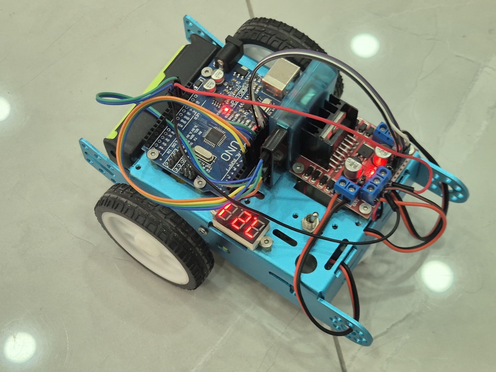

# Thử xe ba bánh - gồm 4 bước

- xe chuyển động tuần hoàn cho tới khi có điều kiện dừng

## Thẳng tiến
- xe sẽ chạy tới 1 đoạn với tốc độ nhanh dần đều

## Lùi về
- Xe sẽ chạy về 1 đoạn với tốc độ nhanh dần đều

## Quay trái
- Quay trái cùng với bánh trái đứng yên và bánh phải chuyển động tạo ra 1 vòng quay đơn về phía bên trái

## Quay phải
- Quay phải cùng với bánh phải đứng yên và bánh trái chuyển động tạo ra 1 vòng quay đơn về phía bên phải

